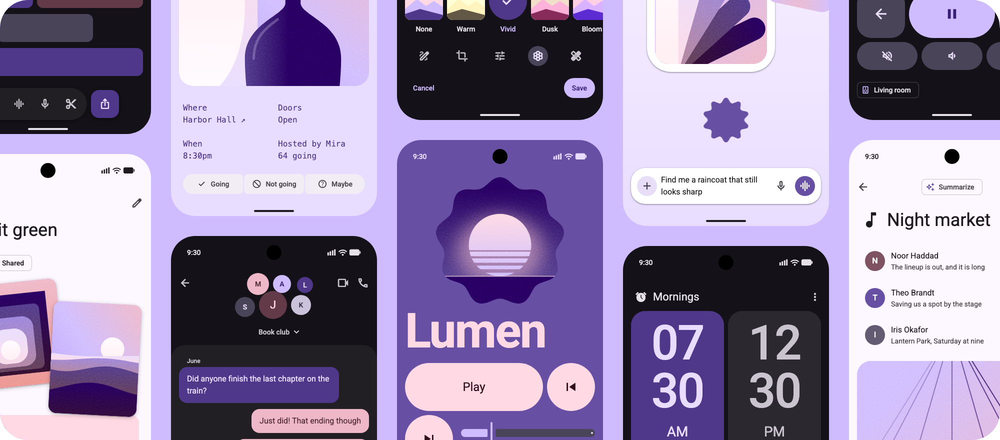
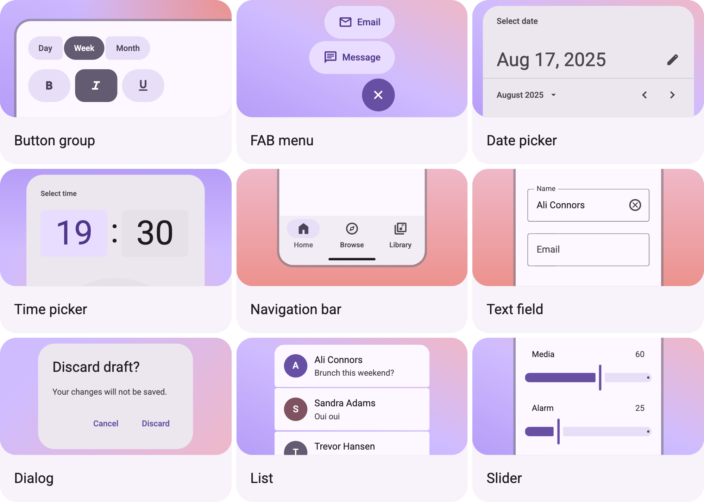
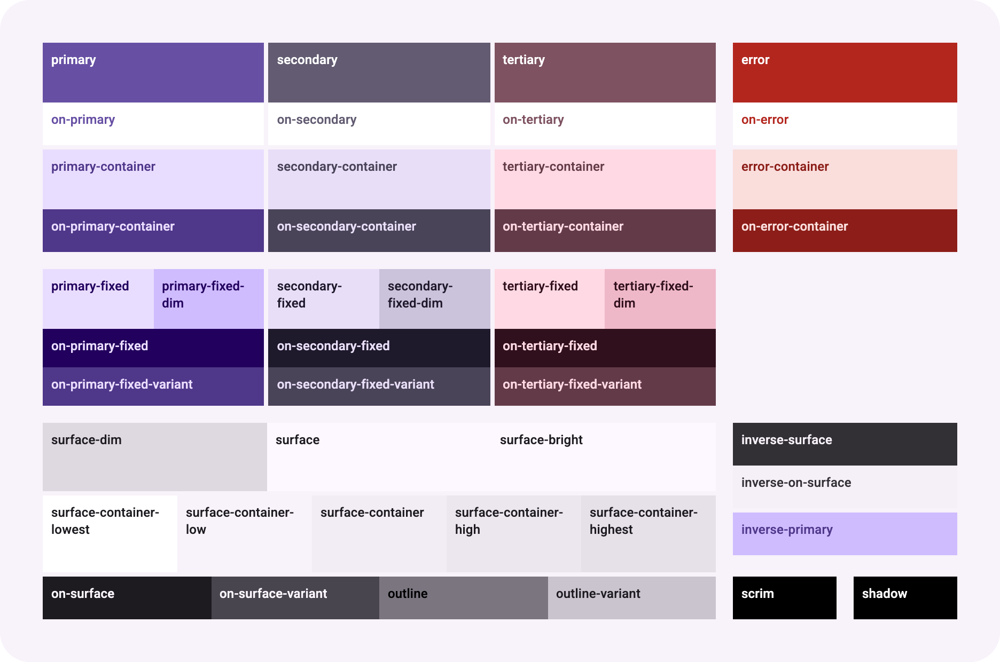

<div align="center">

# Material 3 for React & Tailwind

Two libraries that bring [Material Design 3](https://m3.material.io) to [React](https://react.dev) and [Tailwind CSS](https://tailwindcss.com).

[Installation](#installation) · [React components](packages/react#readme) · [Tailwind theme](packages/tailwind#readme) · [Development](#development)

</div>

`@material-web/react` is a library of accessible React components, and `@material-web/tailwind` is a theme that provides the Material 3 design tokens for Tailwind CSS v4.

> **Beta.** Both libraries are in beta. Their APIs may change between releases until the first stable version.

## Libraries

| Library                                              | Use                                                                                                    | Requires                  |
| ---------------------------------------------------- | ------------------------------------------------------------------------------------------------------ | ------------------------- |
| [`@material-web/react`](packages/react#readme)       | Material 3 components, ready to use in a React app                                                     | React 19, Tailwind CSS v4 |
| [`@material-web/tailwind`](packages/tailwind#readme) | The design tokens as Tailwind classes and CSS custom properties, for your own markup, in any framework | Tailwind CSS v4           |

The two work together or apart. The components come with the theme, and the theme can be used on its own.

Both follow the Material 3 Expressive specification, and support light and dark color schemes, contrast levels, forced-colors mode and reduced motion.

Some of the components, in the documentation site's cards:

<picture>
  <source media="(prefers-color-scheme: dark)" srcset=".github/assets/components-dark.png">
  
</picture>

The color roles of the theme, each a Tailwind class such as `bg-primary` or `text-on-primary-container`, and a CSS custom property. They follow the color scheme and the contrast level:

<picture>
  <source media="(prefers-color-scheme: dark)" srcset=".github/assets/color-roles-dark.png">
  
</picture>

## Installation

Both libraries need Tailwind CSS v4 in your project. To add it, follow Tailwind's [installation guide](https://tailwindcss.com/docs/installation).

### React components

```sh
npm install @material-web/react
```

```css
@import 'tailwindcss';
@import '@material-web/react';
```

```tsx
import { Button, Icon } from '@material-web/react'

export function SaveButton({ onSave }: { onSave: () => void }) {
  return (
    <Button variant="tonal" onPress={onSave}>
      <Icon name="save" />
      Save
    </Button>
  )
}
```

### Tailwind theme only

```sh
npm install @material-web/tailwind
```

```css
@import 'tailwindcss';
@import '@material-web/tailwind';
```

```html
<div
  class="rounded-shape-lg bg-primary-container p-space-200 text-on-primary-container shadow-elevation-1"
>
  <h2 class="text-title-lg">Material 3</h2>
  <p class="text-body-md">The tokens, as Tailwind classes.</p>
</div>
```

### Fonts

Import Roboto and Material Symbols Outlined from Google Fonts at the top of your CSS, above any other import:

```css
@import url('https://fonts.googleapis.com/css2?family=Roboto:wght@400;500;700&family=Material+Symbols+Outlined:opsz,wght,FILL,GRAD@20..48,100..700,0..1,-50..200');
```

## Development

The repository is an npm workspace. Run every command from its root.

```sh
npm install
npx playwright install chromium  # once, for the browser tests
npm run dev                      # the documentation site, on port 5173
npm run storybook                # Storybook, on port 6006
npm test                         # unit tests in jsdom, *.browser.test.tsx in Chromium
npm run typecheck
npm run lint
npm run build                    # both libraries and the documentation site
npm run tokens:generate          # regenerate packages/tailwind/src/theme-default.css
```

| Folder              | Contents                                                                                                                                                                                                                                                                                                     |
| ------------------- | ------------------------------------------------------------------------------------------------------------------------------------------------------------------------------------------------------------------------------------------------------------------------------------------------------------ |
| `packages/tailwind` | `@material-web/tailwind`. `src/` is published as written, with no build. `src/theme-default.css` is generated: change `scripts/generate-tokens.mjs` and run `npm run tokens:generate`, never edit the file. The generator is also the package's `material3-theme` command, bundled into `dist/`.             |
| `packages/react`    | `@material-web/react`. `src/components/` holds a folder per component, with its CSS and tests. `src/tailwind.css` is the package's stylesheet, published with its imports inlined. `src/lib/` holds the shared `tv` and `twMerge`, and the helpers the components share around React Aria. Built to `dist/`. |
| `packages/docs`     | The documentation site, a private package: React Router, Vite and MDX, prerendered to static HTML in `dist/client`. `src/nav.ts` is the site map, `src/content/` holds the pages and `src/examples/` the examples they run. Set `DOCS_BASE` to serve the site under a path other than `/`.                   |

- **Releases:** The two libraries share one version, and `@material-web/react` depends on `@material-web/tailwind` at exactly that version. `npm run release -- 0.2.0` sets that version in every workspace, then commits and tags `v0.2.0`. Pushing the tag with `git push --follow-tags` runs the [publish workflow](.github/workflows/publish.yml), which publishes both packages to npm through [trusted publishing](https://docs.npmjs.com/trusted-publishers), with no token, then creates the tag's GitHub release with generated notes. A prerelease, such as `0.2.0-beta.1`, is published under the `next` tag and marked as a prerelease on GitHub. Each package runs the checks and its build before it is published.
- **TypeScript:** Pinned to 6.0, since typescript-eslint and Storybook's docgen do not support 7.x yet.

## License

[MIT](LICENSE). Material Design is a trademark of Google LLC; this project is independent and not affiliated with or endorsed by Google.
